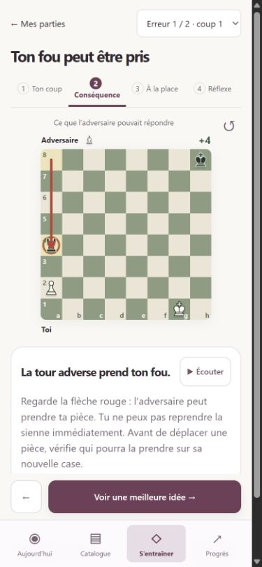
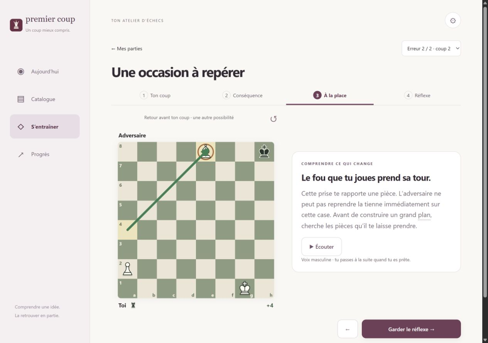

# Revue guidée et fiche des essentiels · 2.10.0

## Vérifications

- 73 tests automatisés réussis. Nouveaux cas : prise sans reprise, échange avec reprise, position sans perte immédiate malgré une forte estimation du moteur, mat observable, camp noir et réponse invalide dans un ancien rapport.
- Les sept exemples et leurs 18 étapes sont légaux. Les tests vérifient aussi les conséquences enseignées : fou perdu, cases centrales attaquées, cavalier développé, roque, tour gagnée par double attaque, échange coûtant six points et roi protégeant son pion.
- Les 41 fichiers de narration correspondent exactement aux transcriptions et à leur empreinte ; fichiers décodables avec durée positive. Narration synthétique neuronale masculine Henri, générée à partir des textes généraux, sans donnée personnelle.
- Validation du catalogue existant : 72 fiches, 510 positions, 433 demi-coups. Aucune modification de la sauvegarde, de la maîtrise des leçons ni du classement.
- Interface contrôlée dans le navigateur à 390 × 844 et 1280 × 900. La revue mobile affiche le plateau, le texte et le bouton suivant sans débordement horizontal. Les couleurs et les captures restent correctes quand les noirs sont en bas.
- Démarrage effectif du fichier audio, animation associée et interruption lors d’un changement d’étape vérifiés. La lecture manuelle reste arrêtée après l’explication ; la lecture continue aboutit au bilan. Les refus de lecture et l’annulation sont couverts par un faux lecteur Audio contrôlable dans les tests.
- Une ancienne partie de test conservée dans le navigateur local reçoit les nouveaux textes sans réanalyse. Sélecteur de deux erreurs, retour avant le coup, prise alternative, bilan et accès à la correction vérifiés.
- Fiche accessible dans l’application complète : changement de principe, exemple du centre, animation et narration. Les titres et les boutons de dépliage ne sont plus détournés par les liens automatiques du glossaire.
- Aucun journal d’erreur du navigateur observé pendant ces parcours.

Il s’agit de tests dans un navigateur aux dimensions d’un téléphone, pas d’une validation sur un iPhone physique. Le timbre vocal reste synthétique ; aucune imitation d’un professeur réel. Les positions dont l’intérêt dépend d’une suite longue sont annoncées comme telles, sans inventer une perte de pièce.

## Captures

